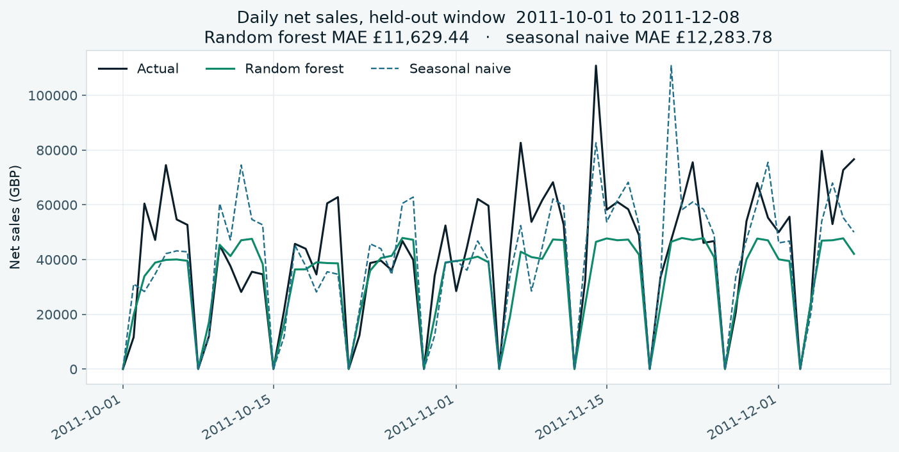
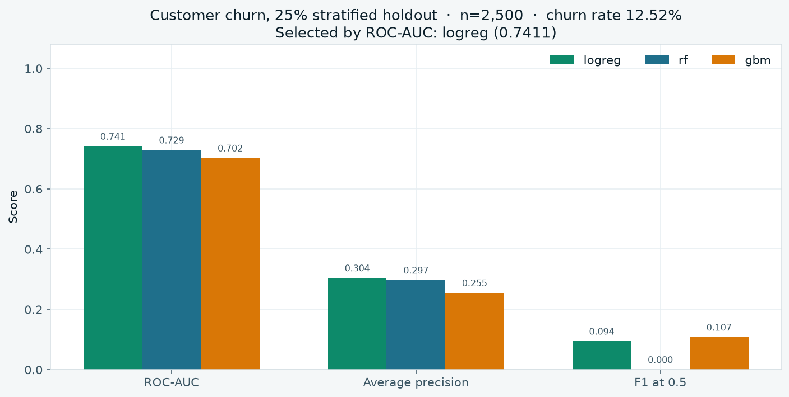
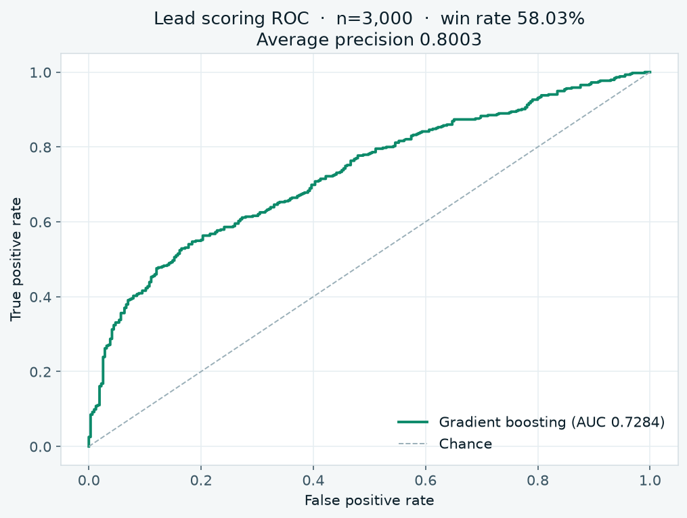
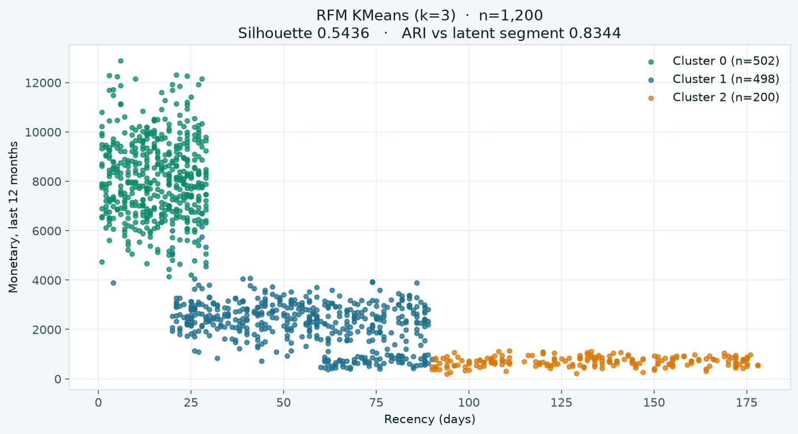
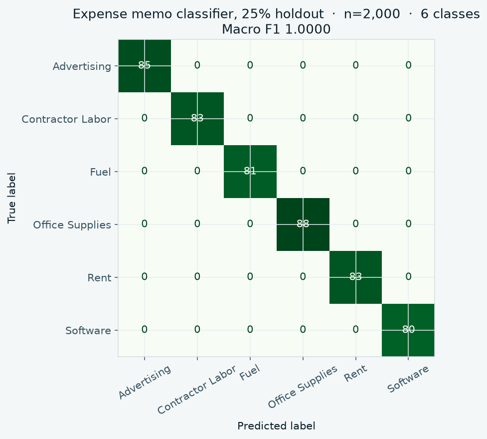
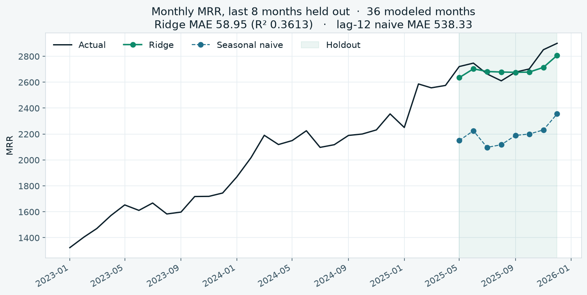
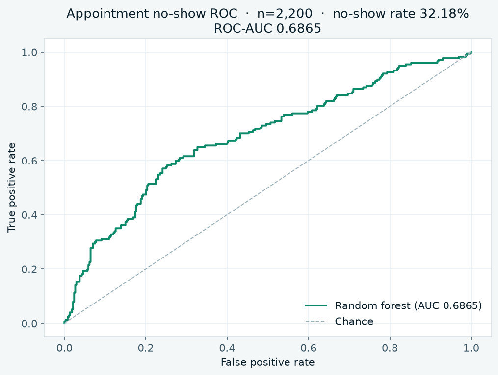
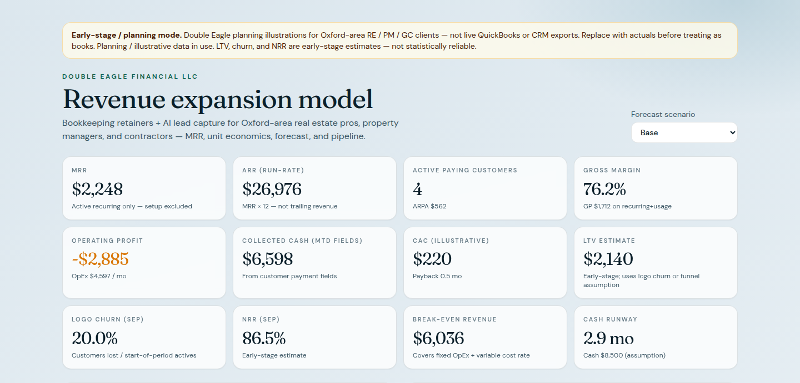
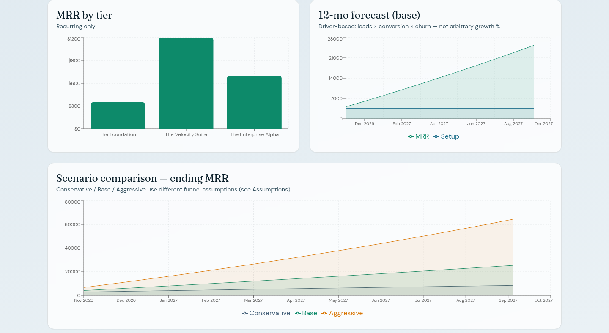

# Revenue Prediction Model — ML Portfolio

Machine learning projects for revenue, retention, and operations — plus the **Double Eagle Financial** planning dashboard.

**Owner:** Ladarius Jackson ([@ladariusjackson1](https://github.com/ladariusjackson1))

[](https://github.com/ladariusjackson1/revenue-prediction-model/actions/workflows/ml-ci.yml)
[](docs/COVERAGE.md)

## Revenue quality (the case study)

The forecasting projects sit on top of a prior question: is the revenue number defensible?

[`finance/`](finance/) loads the public [UCI Online Retail](https://archive.ics.uci.edu/dataset/352/online+retail) invoice extract (CC BY 4.0) into SQLite as raw text, a typed staging table, and marts. Merchandise net sales are **£9,762,760.55** for 1 Dec 2010–8 Dec 2011. That daily mart matches project 01's series to the penny. Cancellation invoices reduce it by £310,159.80. Exact duplicate extras of £21,371.10 are kept in that total and shown separately. 130,547 kept lines have no customer id (£1,491,723.13); they stay in revenue and out of the cohort. 4,361 identified customers, 1,122 of whom also buy in the following month.

This is a public research extract, not a client ledger and not an ROI. The 19-row file under `finance/fixtures/` is a planted test fixture, not a sample of the workbook. Provenance, the sha256, and the rebuild rule are in [`finance/PROVENANCE.md`](finance/PROVENANCE.md).

```bash
python -m finance.run
```

That command needs no download. It tests duplicate handling, returns, cancellations, bad prices, a partial final day, idempotent reruns, and a reconciliation that fails if a daily total is edited. The static explorer is [`docs/revenue-quality/index.html`](docs/revenue-quality/index.html) (open the file; it does not call a server). Narrative, dictionary, and a short interview walkthrough: [`finance/README.md`](finance/README.md).

## Key results

These figures come from the training scripts in this repo. Project 01 is the public UCI Online Retail daily series. Projects 02–07 are synthetic tables with fixed random seeds. Re-running `python -m src.train` (or `python train.py` for project 01) reprints the same scores, and the tests check them.

| Project | Data | Model | Result |
| --- | --- | --- | --- |
| [01 Daily sales forecast](projects/01-daily-sales-forecast) | UCI Online Retail, 373 calendar days, 345 modeled. Test window 2011-10-01 to 2011-12-08 (69 days) | Random forest, chosen by validation MAE | Test MAE **£11,629.44** (RMSE £16,509.50, R² 0.5392). Seasonal naive test MAE £12,283.78 |
| [02 Customer churn](projects/02-customer-churn) | 2,500 synthetic clients, churn rate 12.52% | Logistic regression, highest ROC-AUC of logreg / random forest / gradient boosting | ROC-AUC **0.7411**, average precision 0.3042. F1 at a 0.5 cutoff is 0.0941 |
| [03 Lead scoring](projects/03-lead-scoring) | 3,000 synthetic leads, win rate 58.03% | Gradient boosting | ROC-AUC **0.7284**, average precision 0.8003 |
| [04 Customer segmentation](projects/04-customer-segmentation) | 1,200 synthetic RFM customers | KMeans, k=3, on scaled recency / frequency / monetary | Silhouette **0.5436**. Adjusted Rand index vs the latent segment is 0.8344. Cluster sizes 502 / 498 / 200 |
| [05 Expense memo classifier](projects/05-expense-classifier) | 2,000 synthetic memos, 6 categories | TF-IDF + logistic regression | Macro F1 **1.0** on the 25% holdout. The memos are built from category templates, so a perfect score is expected and is not a claim about real bank text |
| [06 MRR forecast](projects/06-mrr-forecast) | 48 synthetic months, 36 left after lag features. Last 8 months held out | Ridge, lowest test MAE | Test MAE **58.95** (R² 0.3613). Lag-12 naive MAE on the same window is 538.33 |
| [07 Appointment no-show](projects/07-appointment-noshow) | 2,200 synthetic appointments, no-show rate 32.18% | Random forest | ROC-AUC **0.6865** |

Saved copies of these scores live in each project's `models/metrics.json`.

## Charts

`python scripts/export_figures.py` redraws these from the training code and refuses to write a file if the number on the chart disagrees with `metrics.json`.

### Daily sales, held-out window



### Customer churn



### Lead scoring



### Customer segments



### Expense memos



### MRR forecast



### Appointment no-show



## Dashboard

The Next.js app is a planning model for Double Eagle Financial (bookkeeping retainers and an AI lead-capture add-on). The numbers on screen are computed from `src/data/assumptions.ts` and `src/data/customers.ts`. They are planning illustrations, not closed books.





## Projects

| # | Project | Type | Path |
|---|---------|------|------|
| 01 | Daily sales forecast (UCI Online Retail) | Time series regression | [`projects/01-daily-sales-forecast`](projects/01-daily-sales-forecast) |
| 02 | Customer churn | Binary classification | [`projects/02-customer-churn`](projects/02-customer-churn) |
| 03 | Lead scoring (RE / PM / GC) | Binary classification | [`projects/03-lead-scoring`](projects/03-lead-scoring) |
| 04 | Customer segmentation (RFM) | Clustering | [`projects/04-customer-segmentation`](projects/04-customer-segmentation) |
| 05 | Expense memo classifier | Text classification | [`projects/05-expense-classifier`](projects/05-expense-classifier) |
| 06 | MRR forecast | Time series regression | [`projects/06-mrr-forecast`](projects/06-mrr-forecast) |
| 07 | Appointment no-show | Binary classification | [`projects/07-appointment-noshow`](projects/07-appointment-noshow) |

## App

| App | Description | Path |
|-----|-------------|------|
| Double Eagle revenue model | Next.js MRR / pricing / forecast dashboard for bookkeeping + AI packages | [`apps/double-eagle-revenue-model`](apps/double-eagle-revenue-model) |

## Quick start (ML)

```bash
python -m venv .venv
source .venv/bin/activate
pip install -r requirements.txt

# Train + test every project, then write the coverage report
bash scripts/ci_ml.sh \
  01-daily-sales-forecast \
  02-customer-churn \
  03-lead-scoring \
  04-customer-segmentation \
  05-expense-classifier \
  06-mrr-forecast \
  07-appointment-noshow

python scripts/export_figures.py
```

Project 01 uses the committed UCI-derived daily series (`python train.py`). Projects 02–07 generate synthetic data with fixed seeds.

## Double Eagle dashboard

```bash
cd apps/double-eagle-revenue-model
npm ci
npm run dev
```

Open http://127.0.0.1:43211

`npm test` runs the formula tests. `npm run build` is the production build Vercel runs.

## Deploy the dashboard on Vercel

The Python projects stay in this repository. Vercel should build only the Next.js app.

1. Sign in at [vercel.com](https://vercel.com) and choose **Add New… → Project**.
2. Import `ladariusjackson1/revenue-prediction-model`.
3. Set **Root Directory** to `apps/double-eagle-revenue-model`. Leave the framework preset on **Next.js**. This is the step that matters: the repository root is not a Node app, so a deploy pointed at `/` will not find the dashboard.
4. Leave the commands from `apps/double-eagle-revenue-model/vercel.json` in place:
   - Install: `npm ci` (the lockfile is committed)
   - Build: `npm run build`
   - Do not set a static output directory. Vercel hosts the Next.js build itself.
5. No environment variables are required. Prices, customers, and funnel rates live in `src/data/assumptions.ts` and `src/data/customers.ts`.
6. Deploy. Node.js 20 or newer (`engines` in `package.json`).

`npm run dev` and `npm start` bind to `127.0.0.1:43211` for local use. Vercel does not use those scripts; it serves the output of `next build`.

The first build downloads the DM Sans and Fraunces font files through `next/font`. The Vercel build needs outbound network access for that, which the default environment has.

## CI

[`.github/workflows/ml-ci.yml`](.github/workflows/ml-ci.yml) does three jobs:

- **test** — Python 3.12, root `requirements.txt`, then `scripts/ci_ml.sh` for all seven projects (generate, train, pytest, combined coverage). The job fails if `docs/COVERAGE.md` or the coverage badge disagrees with that run. The HTML report is the `coverage-report` artifact.
- **revenue-quality** — `python -m finance.run`. Offline fixture tests for the ledger, then a check that the static explorer still matches the committed UCI snapshot.
- **dashboard** — `npm ci`, `npm test`, and `npm run build` in `apps/double-eagle-revenue-model`.

Statement coverage for the seven projects — data generation, training, and pytest — is written up in [`docs/COVERAGE.md`](docs/COVERAGE.md).
